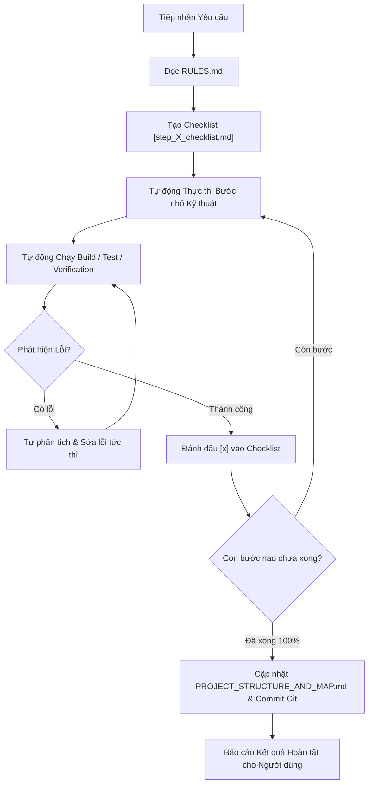

# Kỹ năng Thực thi Tự chủ & Hoàn thành Nhiệm vụ Toàn diện (Autonomous Task Execution Skill)

Kỹ năng này hướng dẫn AI Agent tự chủ thực thi xuyên suốt mọi giai đoạn của một yêu cầu hoặc nhiệm vụ kỹ thuật từ người dùng cho đến khi đạt kết quả nghiệm thu 100%, không gián đoạn để xin quyền hay hỏi ý kiến trung gian.

---

## 🎯 1. NGUYÊN TẮC CỐT LÕI (CORE PRINCIPLES)

1. **Quyền Tự chủ Toàn diện (Full Autonomy):**
   - Tự động chấp nhận và triển khai tất cả các bước kỹ thuật cần thiết để hoàn thành yêu cầu.
   - Không dừng lại giữa chừng để hỏi "Tôi có nên tiếp tục bước tiếp theo không?", "Tôi có được phép chạy lệnh này không?".
   - Tự động chạy lệnh shell (`run_command`), tạo file (`write_to_file`), chỉnh sửa mã nguồn (`replace_file_content`), cài đặt dependencies (`npm install`), chạy build (`npm run build`), chạy test (`npm run type-check`) và commit Git.

2. **Chỉ Hỏi Khi Có Hành Động Phá Hủy Không Thể Khôi Phục (Destructive Guardrail):**
   - **CHỈ DỪNG LẠI XIN Ý KIẾN NGƯỜI DÙNG KHI VÀ CHỈ KHI:**
     - Cần xóa vĩnh viễn file hoặc thư mục trong dự án.
     - Thực thi lệnh có tính hủy diệt database (`DROP DATABASE`, `TRUNCATE`, xóa dữ liệu người dùng không thể khôi phục).
     - Thực thi lệnh Git nguy hiểm làm mất commit lịch sử (`git reset --hard`, `git push --force`).

---

## 🔄 2. QUY TRÌNH THỰC THI LIÊN TỤC (CONTINUOUS EXECUTION LOOP)

Khi tiếp nhận nhiệm vụ từ người dùng, thực thi nghiêm ngặt theo chu trình khép kín sau:

### Chi tiết các bước:
1. **Khởi tạo & Đọc Luật:** Luôn đọc lại [RULES.md](file:///D:/WORKSPACE/PROJECT/CLASS_PROJECT/MNM_PROJECT/SNOTE/RULES.md) trước khi bắt đầu.
2. **Lập Checklist:** Tạo bảng checklist theo dõi `DOCS/step_X_checklist.md` với các tiêu chí nghiệm thu rõ ràng.
3. **Thực thi Không Xin Phép:** Tự động tạo file, cài đặt package, cấu hình, viết code modules và router.
4. **Tự Động Xác Minh & Tự Sửa Lỗi (Self-Healing):**
   - Chạy `npm run build` và `npm run type-check`.
   - Nếu gặp lỗi biên dịch hoặc lỗi runtime, tự động đọc log lỗi, phân tích nguyên nhân và thực hiện sửa lỗi ngay trong cùng phiên làm việc cho đến khi vượt qua 100%.
5. **Cập nhật & Đóng gói:** Cập nhật checklist `[x]`, cập nhật bản đồ mã nguồn [DOCS/PROJECT_STRUCTURE_AND_MAP.md](file:///D:/WORKSPACE/PROJECT/CLASS_PROJECT/MNM_PROJECT/SNOTE/DOCS/PROJECT_STRUCTURE_AND_MAP.md), sổ tay lệnh [DOCS/COMMANDS_PLAYBOOK.md](file:///D:/WORKSPACE/PROJECT/CLASS_PROJECT/MNM_PROJECT/SNOTE/DOCS/COMMANDS_PLAYBOOK.md) và tạo Git commit.
6. **Báo cáo:** Trình bày kết quả hoàn thành và các file liên quan cho người dùng.

---

## ⚡ 3. HƯỚNG DẪN HÀNH VI CỤ THỂ

- **Khi cần cài package mới:** Tự động chạy `npm install <package>` trong thư mục tương ứng (`backend/`, `frontend/`, `packages/shared/` hoặc root).
- **Khi cần sinh Prisma Client:** Tự động chạy `npx prisma generate` hoặc `npm run prisma:generate`.
- **Khi cần tạo router/module mới:** Tự động hoàn thiện đầy đủ các layer: Types $\rightarrow$ Schema $\rightarrow$ Repo $\rightarrow$ Service $\rightarrow$ Controller $\rightarrow$ Routes $\rightarrow$ Index và đăng ký vào `server.ts`.
- **Khi hoàn thành:** Đảm bảo toàn bộ Monorepo build 0 lỗi trước khi bàn giao.
