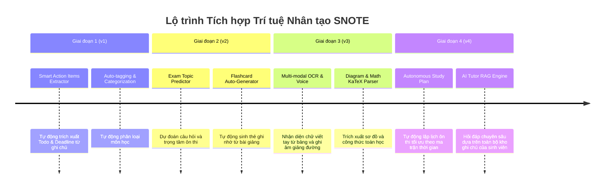

# 05 – LỘ TRÌNH AI & CHIẾN LƯỢC PHÁT TRIỂN TƯƠNG LAI (SNOTE AI STRATEGY)

Tài liệu này ghi nhận **chiến lược và lộ trình 4 giai đoạn tích hợp Trí tuệ Nhân tạo (AI)** vào hệ thống **SNOTE** sau khi hoàn thành phần lõi Non-AI.

---

## 🧭 LỘ TRÌNH 4 GIAI ĐOẠN AI (AI ROADMAP)

---

## 🎯 CHI TIẾT TỪNG GIAI ĐOẠN

### 1. Giai đoạn 1 (AI v1) – Smart Action Items & Auto-tagging
* **Mục tiêu:** Giảm 80% công sức sinh viên phải tự tay copy todo từ ghi chú sang danh sách công việc.
* **Cơ chế:** Gửi nội dung bài giảng qua LLM (Google Gemini Flash / OpenAI mini) với Structured Outputs (JSON Schema) để trích xuất danh sách:
  * Việc cần làm (`title`, `dueDate`, `priority`).
  * Gắn nhãn tự động (`tags`).
  * Liên kết trực tiếp với môn học đang mở.

### 2. Giai đoạn 2 (AI v2) – Exam Topic Predictor & Flashcards
* **Mục tiêu:** Hỗ trợ tối đa sinh viên trong mùa thi cao điểm.
* **Cơ chế:** Phân tích toàn bộ ghi chú của 1 học kỳ môn học, tìm ra các khái niệm lặp lại nhiều lần, sinh ra:
  * Danh sách 10 câu hỏi cốt lõi có khả năng vào đề thi cao nhất.
  * Bộ thẻ ghi nhớ Spaced Repetition (SRS) để ôn tập ngắt quãng.

### 3. Giai đoạn 3 (AI v3) – Multi-modal Lecture Digestion
* **Mục tiêu:** Chuyển đổi mọi định dạng bài giảng (ảnh chụp bảng, slide PDF, file ghi âm giọng nói) thành ghi chú có cấu trúc trong SNOTE.
* **Cơ chế:** Vision OCR + Audio Whisper transcription + Formatting engine.

### 4. Giai đoạn 4 (AI v4) – Autonomous Study Planner & RAG Second Brain
* **Mục tiêu:** Đóng vai trò là một "Gia sư AI cá nhân hóa" cho từng sinh viên.
* **Cơ chế:**
  * Retrieval-Augmented Generation (RAG) trên vector database (pgvector trong PostgreSQL).
  * Lập lịch ôn tập tự động dựa trên độ khó của môn học và ngày thi thực tế.
