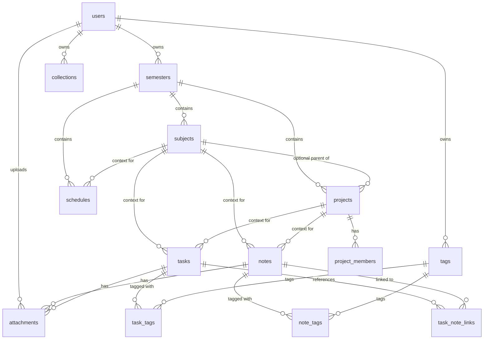

# Bước 2 – Thiết kế Mô hình Dữ liệu & Schema (AI Note)

Tài liệu này chi tiết hóa toàn bộ **mô hình dữ liệu quan hệ (Relational Data Model)** và **schema PostgreSQL** cho dự án **AI Note**, chuyển giao từ các yêu cầu sản phẩm tại **Bước 1**.

Schema được thiết kế tối ưu cho PostgreSQL 16, đảm bảo tính toàn vẹn dữ liệu, hiệu năng truy vấn, khả năng tìm kiếm toàn văn bản (Full-Text Search) và bảo vệ quyền sở hữu dữ liệu cá nhân của sinh viên.

---

## 1. Quy ước Thiết kế Cơ sở Dữ liệu

1. **Hệ quản trị CSDL mục tiêu:** `PostgreSQL 16+`.
2. **Quy chuẩn Khóa chính & Định danh:** Mọi bảng nghiệp vụ sử dụng `id UUID PRIMARY KEY DEFAULT gen_random_uuid()`.
3. **Quyền sở hữu (Multi-Tenant Isolation):** Mọi bảng dữ liệu người dùng đều có trường `user_id UUID NOT NULL` tham chiếu đến `users(id)`.
4. **Chuẩn hóa Thời gian & Múi giờ:**
   - Mọi trường thời gian lưu trữ dưới dạng `TIMESTAMPTZ` (UTC).
   - Chuyển đổi hiển thị sang giờ địa phương dựa vào trường `timezone` trong hồ sơ `users` (mặc định `'Asia/Ho_Chi_Minh'`).
   - Mọi bảng đều có `created_at TIMESTAMPTZ NOT NULL DEFAULT NOW()` và `updated_at TIMESTAMPTZ NOT NULL DEFAULT NOW()`.
5. **Cơ chế Xóa mềm (Soft Delete):** Áp dụng trường `deleted_at TIMESTAMPTZ NULL` cho các thực thể quan trọng (`notes`, `tasks`, `subjects`, `projects`, `schedules`) để đảm bảo không mất dữ liệu học tập khi người dùng vô tình bấm xóa.
6. **Ràng buộc Chống "Note Rác" (Core Business Constraint):**
   - Trong bảng `notes` và `tasks`, bắt buộc phải có ít nhất một ngữ cảnh lưu trữ:
     $$\text{CHECK } (\text{subject\_id IS NOT NULL OR project\_id IS NOT NULL})$$

---

## 2. Danh mục Thực thể & Sơ đồ Quan hệ (ERD)

### 2.1. Danh mục Thực thể Chính

| Nhóm chức năng | Tên bảng | Vai trò & Ý nghĩa nghiệp vụ |
| :--- | :--- | :--- |
| **Tài khoản** | `users` | Người dùng hệ thống, lưu trữ email, hash mật khẩu, timezone, avatar. |
| **Ngữ cảnh học tập** | `semesters` | Học kỳ của sinh viên (ví dụ: Học kỳ 1 2025–2026). |
| | `subjects` | Môn học thuộc học kỳ (ví dụ: Cơ sở dữ liệu, Mạng máy tính). |
| | `projects` | Đồ án, bài tập lớn thuộc học kỳ hoặc môn học. |
| | `project_members`| Thành viên tham gia đồ án nhóm và vai trò. |
| **Tri thức & Ghi chép**| `notes` | Ghi chú bài giảng, tài liệu ôn tập, phân loại theo `note_type`. |
| | `tags` | Kho nhãn cá nhân của sinh viên. |
| | `note_tags` | Bảng liên kết nhiều-nhiều giữa ghi chú và nhãn. |
| **Quản lý Công việc** | `tasks` | Công việc học tập, deadline, độ ưu tiên, trạng thái hoàn thành. |
| | `task_tags` | Bảng liên kết nhiều-nhiều giữa công việc và nhãn. |
| | `task_note_links`| Liên kết nguồn giữa công việc và các ghi chú tham chiếu. |
| **Lịch trình** | `schedules` | Lịch học, lịch thi, sự kiện định kỳ (`schedule_events`). |
| **Bộ sưu tập & Tệp** | `collections` | Thư mục/Bộ sưu tập gom nhóm ghi chú và task. |
| | `attachments` | Metadata tệp đính kèm (PDF, hình ảnh bài giảng). |
| **Chia sẻ & Sao lưu** | `shares` | Quyền chia sẻ tài nguyên cho người khác (view/edit). |
| | `backup_records` | Lịch sử sao lưu và xuất dữ liệu (Markdown, JSON). |

### 2.2. Sơ đồ Quan hệ Thực thể (ERD)



---

## 3. Các Kiểu Dữ liệu Định nghĩa (Enums)

```sql
-- Trạng thái tài khoản người dùng
CREATE TYPE user_status AS ENUM (
  'ACTIVE',
  'SUSPENDED',
  'DELETED'
);

-- Trạng thái học kỳ
CREATE TYPE semester_status AS ENUM (
  'PLANNED',
  'ACTIVE',
  'COMPLETED',
  'ARCHIVED'
);

-- Trạng thái môn học
CREATE TYPE subject_status AS ENUM (
  'ACTIVE',
  'COMPLETED',
  'ARCHIVED'
);

-- Trạng thái đồ án / bài tập lớn
CREATE TYPE project_status AS ENUM (
  'PLANNED',
  'ACTIVE',
  'ON_HOLD',
  'COMPLETED',
  'ARCHIVED'
);

-- Phân loại ghi chú
CREATE TYPE note_type AS ENUM (
  'LECTURE',       -- Bài giảng trên lớp
  'ASSIGNMENT',    -- Hướng dẫn bài tập
  'EXAM_REVIEW',   -- Tổng hợp ôn thi
  'RESOURCE',      -- Tài liệu tham khảo
  'IDEA'           -- Ý tưởng đồ án
);

-- Trạng thái công việc
CREATE TYPE task_status AS ENUM (
  'TODO',
  'IN_PROGRESS',
  'DONE'
);

-- Độ ưu tiên công việc
CREATE TYPE task_priority AS ENUM (
  'LOW',
  'MEDIUM',
  'HIGH'
);

-- Loại sự kiện lịch
CREATE TYPE schedule_type AS ENUM (
  'CLASS',         -- Buổi học trên lớp
  'EXAM',          -- Lịch thi
  'ASSIGNMENT',    -- Hạn nộp bài tập
  'STUDY',         -- Buổi tự học / Ôn tập
  'MEETING',       -- Họp nhóm đồ án
  'OTHER'
);

-- Quyền chia sẻ
CREATE TYPE share_permission AS ENUM (
  'VIEW',
  'COMMENT',
  'EDIT',
  'ADMIN'
);

-- Định dạng xuất dữ liệu
CREATE TYPE backup_format AS ENUM (
  'MARKDOWN',
  'JSON',
  'ZIP'
);
```

---

## 4. Đặc tả Chi tiết Schema Các Bảng (DDL Specifications)

### 4.1. Bảng `users`
```sql
CREATE TABLE users (
  id UUID PRIMARY KEY DEFAULT gen_random_uuid(),
  email VARCHAR(255) UNIQUE NOT NULL,
  password_hash TEXT NOT NULL,
  display_name VARCHAR(150) NOT NULL,
  avatar_url TEXT,
  timezone VARCHAR(64) NOT NULL DEFAULT 'Asia/Ho_Chi_Minh',
  status user_status NOT NULL DEFAULT 'ACTIVE',
  created_at TIMESTAMPTZ NOT NULL DEFAULT NOW(),
  updated_at TIMESTAMPTZ NOT NULL DEFAULT NOW(),
  deleted_at TIMESTAMPTZ NULL
);
```

### 4.2. Bảng `semesters`
```sql
CREATE TABLE semesters (
  id UUID PRIMARY KEY DEFAULT gen_random_uuid(),
  user_id UUID NOT NULL REFERENCES users(id) ON DELETE RESTRICT,
  name VARCHAR(120) NOT NULL,
  academic_year VARCHAR(50) NULL,
  start_date DATE NOT NULL,
  end_date DATE NOT NULL,
  status semester_status NOT NULL DEFAULT 'PLANNED',
  is_current BOOLEAN NOT NULL DEFAULT FALSE,
  created_at TIMESTAMPTZ NOT NULL DEFAULT NOW(),
  updated_at TIMESTAMPTZ NOT NULL DEFAULT NOW(),
  archived_at TIMESTAMPTZ NULL,
  CONSTRAINT chk_semester_dates CHECK (end_date >= start_date),
  CONSTRAINT uq_user_semester_name UNIQUE (user_id, name)
);
```

### 4.3. Bảng `subjects`
```sql
CREATE TABLE subjects (
  id UUID PRIMARY KEY DEFAULT gen_random_uuid(),
  user_id UUID NOT NULL REFERENCES users(id) ON DELETE RESTRICT,
  semester_id UUID NOT NULL REFERENCES semesters(id) ON DELETE RESTRICT,
  name VARCHAR(200) NOT NULL,
  code VARCHAR(50) NULL,
  description TEXT NULL,
  credits SMALLINT NULL CHECK (credits > 0),
  color VARCHAR(20) NULL DEFAULT '#3B82F6',
  status subject_status NOT NULL DEFAULT 'ACTIVE',
  created_at TIMESTAMPTZ NOT NULL DEFAULT NOW(),
  updated_at TIMESTAMPTZ NOT NULL DEFAULT NOW(),
  deleted_at TIMESTAMPTZ NULL,
  CONSTRAINT uq_user_semester_subject_name UNIQUE (user_id, semester_id, name)
);
```

### 4.4. Bảng `projects` & `project_members`
```sql
CREATE TABLE projects (
  id UUID PRIMARY KEY DEFAULT gen_random_uuid(),
  user_id UUID NOT NULL REFERENCES users(id) ON DELETE RESTRICT,
  semester_id UUID NOT NULL REFERENCES semesters(id) ON DELETE RESTRICT,
  subject_id UUID NULL REFERENCES subjects(id) ON DELETE SET NULL,
  name VARCHAR(200) NOT NULL,
  description TEXT NULL,
  status project_status NOT NULL DEFAULT 'PLANNED',
  start_date DATE NULL,
  due_at TIMESTAMPTZ NULL,
  created_at TIMESTAMPTZ NOT NULL DEFAULT NOW(),
  updated_at TIMESTAMPTZ NOT NULL DEFAULT NOW(),
  deleted_at TIMESTAMPTZ NULL
);

CREATE TABLE project_members (
  id UUID PRIMARY KEY DEFAULT gen_random_uuid(),
  project_id UUID NOT NULL REFERENCES projects(id) ON DELETE CASCADE,
  user_id UUID NOT NULL REFERENCES users(id) ON DELETE RESTRICT,
  role VARCHAR(50) NOT NULL DEFAULT 'MEMBER',
  joined_at TIMESTAMPTZ NOT NULL DEFAULT NOW(),
  CONSTRAINT uq_project_member UNIQUE (project_id, user_id)
);
```

### 4.5. Bảng `notes` (Kèm Ràng buộc Ngữ cảnh & Full-Text Search)
```sql
CREATE TABLE notes (
  id UUID PRIMARY KEY DEFAULT gen_random_uuid(),
  user_id UUID NOT NULL REFERENCES users(id) ON DELETE RESTRICT,
  semester_id UUID NOT NULL REFERENCES semesters(id) ON DELETE RESTRICT,
  subject_id UUID NULL REFERENCES subjects(id) ON DELETE SET NULL,
  project_id UUID NULL REFERENCES projects(id) ON DELETE SET NULL,
  collection_id UUID NULL,
  title VARCHAR(300) NOT NULL,
  content TEXT NOT NULL DEFAULT '',
  note_type note_type NOT NULL DEFAULT 'LECTURE',
  is_pinned BOOLEAN NOT NULL DEFAULT FALSE,
  is_archived BOOLEAN NOT NULL DEFAULT FALSE,
  search_vector tsvector GENERATED ALWAYS AS (
    to_tsvector('simple', coalesce(title, '') || ' ' || coalesce(content, ''))
  ) STORED,
  created_at TIMESTAMPTZ NOT NULL DEFAULT NOW(),
  updated_at TIMESTAMPTZ NOT NULL DEFAULT NOW(),
  deleted_at TIMESTAMPTZ NULL,
  -- Ràng buộc chống note rác:
  CONSTRAINT chk_note_context CHECK (subject_id IS NOT NULL OR project_id IS NOT NULL)
);
```

### 4.6. Bảng `tasks`
```sql
CREATE TABLE tasks (
  id UUID PRIMARY KEY DEFAULT gen_random_uuid(),
  user_id UUID NOT NULL REFERENCES users(id) ON DELETE RESTRICT,
  semester_id UUID NOT NULL REFERENCES semesters(id) ON DELETE RESTRICT,
  subject_id UUID NULL REFERENCES subjects(id) ON DELETE SET NULL,
  project_id UUID NULL REFERENCES projects(id) ON DELETE SET NULL,
  parent_task_id UUID NULL REFERENCES tasks(id) ON DELETE CASCADE,
  title VARCHAR(300) NOT NULL,
  description TEXT NULL,
  status task_status NOT NULL DEFAULT 'TODO',
  priority task_priority NOT NULL DEFAULT 'MEDIUM',
  due_at TIMESTAMPTZ NULL,
  completed_at TIMESTAMPTZ NULL,
  estimated_minutes INTEGER NULL CHECK (estimated_minutes IS NULL OR estimated_minutes > 0),
  actual_minutes INTEGER NULL CHECK (actual_minutes IS NULL OR actual_minutes >= 0),
  search_vector tsvector GENERATED ALWAYS AS (
    to_tsvector('simple', coalesce(title, '') || ' ' || coalesce(description, ''))
  ) STORED,
  created_at TIMESTAMPTZ NOT NULL DEFAULT NOW(),
  updated_at TIMESTAMPTZ NOT NULL DEFAULT NOW(),
  deleted_at TIMESTAMPTZ NULL,
  -- Ràng buộc:
  CONSTRAINT chk_task_context CHECK (subject_id IS NOT NULL OR project_id IS NOT NULL),
  CONSTRAINT chk_task_completion CHECK (completed_at IS NULL OR status = 'DONE')
);
```

### 4.7. Bảng `tags`, `note_tags`, `task_tags` & `task_note_links`
```sql
CREATE TABLE tags (
  id UUID PRIMARY KEY DEFAULT gen_random_uuid(),
  user_id UUID NOT NULL REFERENCES users(id) ON DELETE RESTRICT,
  name VARCHAR(100) NOT NULL,
  color VARCHAR(20) NULL DEFAULT '#6B7280',
  created_at TIMESTAMPTZ NOT NULL DEFAULT NOW(),
  updated_at TIMESTAMPTZ NOT NULL DEFAULT NOW(),
  CONSTRAINT uq_user_tag_name UNIQUE (user_id, name)
);

CREATE TABLE note_tags (
  note_id UUID NOT NULL REFERENCES notes(id) ON DELETE CASCADE,
  tag_id UUID NOT NULL REFERENCES tags(id) ON DELETE CASCADE,
  created_at TIMESTAMPTZ NOT NULL DEFAULT NOW(),
  PRIMARY KEY (note_id, tag_id)
);

CREATE TABLE task_tags (
  task_id UUID NOT NULL REFERENCES tasks(id) ON DELETE CASCADE,
  tag_id UUID NOT NULL REFERENCES tags(id) ON DELETE CASCADE,
  created_at TIMESTAMPTZ NOT NULL DEFAULT NOW(),
  PRIMARY KEY (task_id, tag_id)
);

CREATE TABLE task_note_links (
  task_id UUID NOT NULL REFERENCES tasks(id) ON DELETE CASCADE,
  note_id UUID NOT NULL REFERENCES notes(id) ON DELETE CASCADE,
  relation_type VARCHAR(50) NOT NULL DEFAULT 'REFERENCE',
  created_at TIMESTAMPTZ NOT NULL DEFAULT NOW(),
  PRIMARY KEY (task_id, note_id)
);
```

### 4.8. Bảng `schedules`
```sql
CREATE TABLE schedules (
  id UUID PRIMARY KEY DEFAULT gen_random_uuid(),
  user_id UUID NOT NULL REFERENCES users(id) ON DELETE RESTRICT,
  semester_id UUID NULL REFERENCES semesters(id) ON DELETE CASCADE,
  subject_id UUID NULL REFERENCES subjects(id) ON DELETE SET NULL,
  project_id UUID NULL REFERENCES projects(id) ON DELETE SET NULL,
  task_id UUID NULL REFERENCES tasks(id) ON DELETE SET NULL,
  title VARCHAR(300) NOT NULL,
  description TEXT NULL,
  event_type schedule_type NOT NULL DEFAULT 'CLASS',
  starts_at TIMESTAMPTZ NOT NULL,
  ends_at TIMESTAMPTZ NULL,
  all_day BOOLEAN NOT NULL DEFAULT FALSE,
  location VARCHAR(255) NULL,
  repeat_rule TEXT NULL,
  created_at TIMESTAMPTZ NOT NULL DEFAULT NOW(),
  updated_at TIMESTAMPTZ NOT NULL DEFAULT NOW(),
  deleted_at TIMESTAMPTZ NULL,
  CONSTRAINT chk_schedule_time CHECK (ends_at IS NULL OR ends_at >= starts_at)
);
```

### 4.9. Bảng `attachments`, `collections` & `backup_records`
```sql
CREATE TABLE collections (
  id UUID PRIMARY KEY DEFAULT gen_random_uuid(),
  user_id UUID NOT NULL REFERENCES users(id) ON DELETE RESTRICT,
  parent_collection_id UUID NULL REFERENCES collections(id) ON DELETE CASCADE,
  name VARCHAR(200) NOT NULL,
  description TEXT NULL,
  color VARCHAR(20) NULL,
  icon VARCHAR(50) NULL,
  created_at TIMESTAMPTZ NOT NULL DEFAULT NOW(),
  updated_at TIMESTAMPTZ NOT NULL DEFAULT NOW()
);

CREATE TABLE attachments (
  id UUID PRIMARY KEY DEFAULT gen_random_uuid(),
  user_id UUID NOT NULL REFERENCES users(id) ON DELETE RESTRICT,
  note_id UUID NULL REFERENCES notes(id) ON DELETE CASCADE,
  task_id UUID NULL REFERENCES tasks(id) ON DELETE CASCADE,
  project_id UUID NULL REFERENCES projects(id) ON DELETE CASCADE,
  file_name VARCHAR(255) NOT NULL,
  storage_key TEXT NOT NULL,
  mime_type VARCHAR(100) NULL,
  file_size BIGINT NULL,
  created_at TIMESTAMPTZ NOT NULL DEFAULT NOW()
);

CREATE TABLE backup_records (
  id UUID PRIMARY KEY DEFAULT gen_random_uuid(),
  user_id UUID NOT NULL REFERENCES users(id) ON DELETE RESTRICT,
  format backup_format NOT NULL DEFAULT 'JSON',
  file_path TEXT NOT NULL,
  file_size BIGINT NOT NULL,
  notes_count INTEGER NOT NULL DEFAULT 0,
  tasks_count INTEGER NOT NULL DEFAULT 0,
  created_at TIMESTAMPTZ NOT NULL DEFAULT NOW()
);
```

---

## 5. Chiến lược Indexes & Tối ưu hóa Truy vấn

### 5.1. B-Tree Indexes cho Bộ lọc Đa Tiêu chí
```sql
-- Semesters & Subjects
CREATE INDEX idx_semesters_user_status ON semesters (user_id, status);
CREATE INDEX idx_subjects_user_semester ON subjects (user_id, semester_id) WHERE deleted_at IS NULL;
CREATE INDEX idx_projects_user_semester ON projects (user_id, semester_id) WHERE deleted_at IS NULL;

-- Notes Queries (Lọc theo Môn, Học kỳ, Loại note, sắp xếp ngày sửa)
CREATE INDEX idx_notes_user_semester_updated ON notes (user_id, semester_id, updated_at DESC) WHERE deleted_at IS NULL;
CREATE INDEX idx_notes_user_subject_type ON notes (user_id, subject_id, note_type) WHERE deleted_at IS NULL;
CREATE INDEX idx_notes_user_project ON notes (user_id, project_id) WHERE deleted_at IS NULL;

-- Tasks Queries (Lọc theo Deadline, Mức ưu tiên, Trạng thái)
CREATE INDEX idx_tasks_user_status_due ON tasks (user_id, status, due_at ASC) WHERE deleted_at IS NULL;
CREATE INDEX idx_tasks_user_subject_priority ON tasks (user_id, subject_id, priority, due_at ASC) WHERE deleted_at IS NULL;
CREATE INDEX idx_tasks_user_project ON tasks (user_id, project_id, status) WHERE deleted_at IS NULL;

-- Schedules Query
CREATE INDEX idx_schedules_user_time ON schedules (user_id, starts_at ASC) WHERE deleted_at IS NULL;
```

### 5.2. GIN Indexes cho Tìm kiếm Toàn văn bản (Full-Text Search)
```sql
CREATE INDEX idx_notes_search_vector ON notes USING GIN (search_vector);
CREATE INDEX idx_tasks_search_vector ON tasks USING GIN (search_vector);
```

---

## 6. Chính sách Khóa ngoại & Toàn vẹn Dữ liệu

| Cặp Quan hệ | Chính sách ON DELETE | Lập luận kỹ thuật |
| :--- | :--- | :--- |
| `users` $\rightarrow$ Tất cả các bảng | `RESTRICT` | Không cho phép xóa vật lý người dùng nếu còn dữ liệu; xóa tài khoản qua quy trình soft-delete riêng biệt. |
| `semesters` $\rightarrow$ `subjects` / `projects` | `RESTRICT` | Tránh việc vô tình xóa cả kỳ làm mất toàn bộ môn học và đồ án. |
| `subjects` / `projects` $\rightarrow$ `notes` / `tasks` | `SET NULL` | Cho phép giữ lại note/task nếu còn ngữ cảnh thứ hai; nếu mất cả hai sẽ bị chặn bởi ràng buộc `chk_note_context`. |
| `notes` / `tasks` $\rightarrow$ `note_tags` / `task_tags` | `CASCADE` | Xóa note/task sẽ tự động xóa các liên kết tag tương ứng. |
| `tags` $\rightarrow$ `note_tags` / `task_tags` | `CASCADE` | Xóa tag sẽ tự động gỡ nhãn khỏi các ghi chú và công việc. |

---

## 7. Tiêu chí Hoàn thành Bước 2 (Definition of Done)

- [x] Đã hoàn thiện thiết kế ERD quan hệ logic cho toàn bộ các thực thể học tập.
- [x] Đã định nghĩa đầy đủ 10 bảng dữ liệu chuẩn hóa và 8 custom ENUMs.
- [x] Đã thiết lập ràng buộc CHECK chống "note rác" (`subject_id IS NOT NULL OR project_id IS NOT NULL`).
- [x] Đã xác định toàn bộ B-Tree indexes cho bộ lọc và GIN indexes cho Full-Text Search.
- [x] Đã định nghĩa chính sách khóa ngoại và cơ chế xóa mềm an toàn.

> **Chuyển giao:** Schema Bước 2 là bản đặc tả nền tảng để **Bước 3** xây dựng kiến trúc hệ thống và **Bước 4** sinh mã SQL Migrations thực tế.
