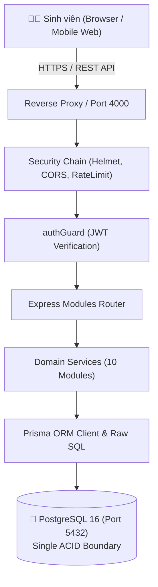

# Bước 3 – Đặc tả Toàn diện Kiến trúc Hệ thống & Nền tảng (SNOTE Architecture Document)

Tài liệu này là **bản đặc tả kiến trúc chính thức và toàn diện nhất** của **Bước 3 lớn (Thiết kế Kiến trúc Hệ thống & Nền tảng)** thuộc dự án **SNOTE**, tổng hợp và chuẩn hóa toàn bộ 7 bước nhỏ (từ 3.1 đến 3.7) trước khi chuyển giao sang **Bước 4 – Triển khai Backend Core & Database Migrations**.

---

## 🧭 MỤC LỤC KIẾN TRÚC

1. [3.1 – Kiến trúc Tổng thể Hệ thống](#1-31--kiến-trúc-tổng-thể-hệ-thống)
2. [3.2 – Ranh giới Module & Domain Bounded Contexts](#2-32--ranh-giới-module--domain-bounded-contexts)
3. [3.3 – Stack Công nghệ Backend](#3-33--stack-công-nghệ-backend)
4. [3.4 – Stack Công nghệ Frontend](#4-34--stack-công-nghệ-frontend)
5. [3.5 – Cấu trúc Repo & Quản lý Thư viện Dùng chung](#5-35--cấu-trúc-repo--quản-lý-thư-viện-dùng-chung)
6. [3.6 – Quản lý Môi trường, Quan sát & Cứng hóa Bảo mật](#6-36--quản-lý-môi-trường-quan-sát--cứng-hóa-bảo-mật)
7. [3.7 – Vận hành, Health Checks & Tiêu chí Chuyển giao Bước 4](#7-37--vận-hành-health-checks--tiêu-chí-chuyển-giao-bước-4)

---

## 1. 3.1 – Kiến trúc Tổng thể Hệ thống

SNOTE được xây dựng theo mô hình **Modular Monolith** phân tầng rõ ràng:
- **Frontend SPA (Client Layer):** React 19 + TypeScript + Vite + React Router DOM.
- **Backend API (Server Layer):** Node.js v24 LTS + Express 5 + TypeScript Strict Mode.
- **Database (Persistence Layer):** PostgreSQL 16 Alpine với 1 database instance duy nhất.
- **Transaction Boundary:** Mọi giao dịch quan trọng (tạo note + gắn tags, tạo task + schedule) đều được bao bọc trong **1 Transaction ACID duy nhất** tại Backend và PostgreSQL.
- **Định hướng Tương lai:** Tách riêng các module nặng tính toán (như AI Service) thành sidecar/microservice độc lập khi triển khai AI Roadmap ở Bước 7.



---

## 2. 3.2 – Ranh giới Module & Domain Bounded Contexts

Hệ thống được chia thành **10 Bounded Contexts độc lập** với quan hệ phụ thuộc 1 chiều (Acyclic Graph):

1. **`auth` & `users`:** Quản lý tài khoản, mã hóa mật khẩu bcrypt, phát hành Dual-Token JWT (Access + Refresh Cookie).
2. **`semesters` & `subjects`:** Quản lý học kỳ, môn học, số tín chỉ, giảng viên.
3. **`projects`:** Quản lý đồ án môn học, nhóm sinh viên, deadline đồ án.
4. **`notes`:** Quản lý ghi chú bài giảng, tài liệu ôn thi (Bắt buộc gắn với `subject_id` hoặc `project_id`).
5. **`tasks`:** Quản lý công việc sinh viên theo trạng thái Kanban (`TODO`, `IN_PROGRESS`, `DONE`, `CANCELLED`).
6. **`schedule`:** Quản lý lịch học theo tuần, lịch thi, sự kiện nhóm.
7. **`search`:** Tìm kiếm toàn văn (PostgreSQL Full-Text Search `tsvector` + GIN Index).
8. **`backup`:** Xuất/Nhập dữ liệu toàn bộ tài khoản ra định dạng JSON chuẩn.
9. **`health`:** Giám sát liveness và readiness của hệ thống.
10. **`ai` (Future):** Phân hệ trích xuất Todo, dự đoán đề thi và gia sư RAG.

---

## 3. 3.3 – Stack Công nghệ Backend

* **Ngôn ngữ & Runtime:** Node.js LTS `v24.15.0`, TypeScript `5.7.3` (`strict: true`, target `ES2022`).
* **Framework:** Express `5.2.1` (`app.disable('x-powered-by')`).
* **Database & ORM:** PostgreSQL 16 Alpine, Prisma ORM `v7.10.0` (kết hợp Raw SQL `$queryRaw` cho các tính năng FTS, triggers).
* **Validation:** Zod `3.23.8` (Fail-Fast startup check + DTO request validation).

---

## 4. 3.4 – Stack Công nghệ Frontend

* **Nền tảng:** Vite `6.4.3` + React `19.0.0` + TypeScript `5.7.3`.
* **Định tuyến:** React Router DOM `7.x` (`/notes`, `/tasks`, `/schedule`, `/semesters`, `/status`).
* **Kiến trúc:** Feature-based (`src/features/<feature>/pages`, `components`, `hooks`).
* **Giao diện:** Modern Minimalist Dashboard, CSS Variables tối ưu cho chế độ học tập tập trung.

---

## 5. 3.5 – Cấu trúc Repo & Quản lý Thư viện Dùng chung

* **Mô hình Repo:** Monorepo nhẹ gồm `backend/`, `frontend/` và thư mục source contracts `packages/shared/`.
* **Shared TypeScript Source:** Frontend resolve Enums/DTOs trực tiếp từ `packages/shared/src/`; backend dùng types do Prisma sinh. Source này không được đóng gói hay build riêng.
* **Root Dev Orchestration:** Khởi chạy toàn bộ hệ thống bằng 1 lệnh duy nhất:
  ```bash
  npm run dev
  ```

---

## 6. 3.6 – Quản lý Môi trường, Quan sát & Cứng hóa Bảo mật

* **Startup Fail-Fast:** Server tự động dừng ngay (`process.exit(1)`) nếu phát hiện thiếu hoặc sai biến môi trường.
* **Error Handling:** Phân cấp `AppError` kèm `isOperational` và `context`; bọc async qua `asyncBoundary`.
* **Structured Logging:** Pino Logger ghi định dạng JSON, tự động `redact` che giấu passwords, tokens.
* **Security Middleware Pipeline:**
  1. `disable('x-powered-by')`
  2. `helmet()`
  3. `cors({ origin, credentials: true })`
  4. `express.json({ limit: '1mb' })`
  5. `requestLogger` (Pino HTTP kèm `x-request-id`)
  6. `apiRateLimiter` (100 req/1m) & `loginRateLimiter` (10 req/15m)
  7. `authGuard` (JWT verification chống IDOR)
  8. Domain Routes $\rightarrow$ `errorHandler`.

---

## 7. 3.7 – Vận hành, Health Checks & Tiêu chí Chuyển giao Bước 4

### 7.1. Health Endpoints:
- `GET /health/live`: Kiểm tra HTTP server còn sống (Liveness Probe).
- `GET /health/ready`: Kiểm tra kết nối Database PostgreSQL qua `SELECT 1` (Readiness Probe).

### 7.2. Tiêu chí Nghiệm thu Bước 3 (Done Definition):
1. ✅ Tài liệu kiến trúc toàn diện đã được xuất bản và phê duyệt.
2. ✅ Bộ khung Backend + Frontend + Shared Packages build thành công 100% không lỗi.
3. ✅ Kết nối mạng, CORS và data flow giữa Client và Server hoạt động ổn định.
4. ✅ Toàn bộ quy tắc cốt lõi (Anti-IDOR, Anti-Junk Note, Zod Fail-Fast) đã được cài đặt và kiểm thử.

---

> [!IMPORTANT]
> **Kết luận:** Nền tảng Bước 3 đã hoàn tất xuất sắc 100%. Dự án chính thức đủ điều kiện bước sang **Bước 4 lớn – Triển khai Backend Core & Database Migrations**.
