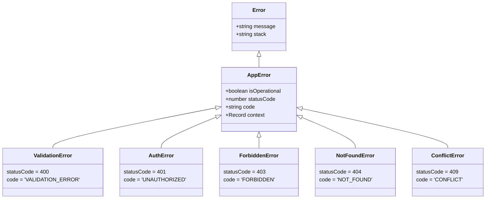

# Bước 3.6 – Quan sát Hệ thống & Cứng hóa Bảo mật Backend (SNOTE)

Tài liệu này thuộc **Bước nhỏ 6** trong cấu trúc 7 bước nhỏ của **Bước 3 lớn (Thiết kế Kiến trúc Hệ thống & Nền tảng)** cho dự án **SNOTE**.

Tài liệu đặc tả chi tiết kiến trúc xử lý lỗi tập trung, mô hình phân cấp `AppError` kèm `isOperational`, cơ chế bọc route `asyncBoundary`, cấu hình Pino Structured Logging che giấu thông tin nhạy cảm (Redaction), chiến lược Rate Limiting và cơ chế bảo vệ xác thực `authGuard` JWT chống tấn công IDOR.

---

## 🧭 VỊ TRÍ TRONG TIẾN TRÌNH BƯỚC 3 LỚN

- **Bước 3.1:** Chọn kiến trúc tổng thể (Modular Monolith, ranh giới 1 transaction ACID trên PostgreSQL).
- **Bước 3.2:** Thiết kế domain nội bộ & ranh giới module (10 Bounded Contexts, Layered Pattern).
- **Bước 3.3:** Chọn stack backend & dựng skeleton từ số 0 (`DOCS/step_3_setup.md`).
- **Bước 3.4:** Chọn stack frontend & thiết lập SPA Feature-based (`DOCS/step_3_frontend.md`).
- **Bước 3.5:** Chốt cấu trúc repo & tổ chức mã nguồn toàn project (`DOCS/step_3_repo_structure.md`).
- **Bước 3.6:** **Chuẩn hóa hệ thống Logging, Error Handling & Bảo mật Backend (Nội dung tài liệu này).**
- **Bước 3.7:** Tổng kết chuẩn bảo mật & chuyển giao sang Bước 4 (Backend Core).

---

## 1. Mô hình Phân cấp Lỗi: `AppError` & `isOperational`

Hệ thống phân biệt rõ ràng giữa **Lỗi nghiệp vụ dự kiến (Operational Error)** và **Lỗi lập trình / hệ thống bất ngờ (Programmer Error)**:



### 1.1. Nguyên tắc Xử lý:
* **Lỗi `isOperational = true`**: Lỗi nghiệp vụ do người dùng nhập sai, không tìm thấy tài nguyên, hoặc sai quyền hạn $\rightarrow$ Ghi log mức `warn` kèm `context`, trả về HTTP status cụ thể (`400`, `401`, `403`, `404`, `409`).
* **Lỗi `isOperational = false` hoặc `Error` thông thường**: Lỗi cú pháp, crash DB, crash null pointer $\rightarrow$ Ghi log mức `error` kèm full stack trace nội bộ, trả về HTTP status `500` dạng chung `{ "error": "INTERNAL_ERROR", "message": "Internal server error" }` nhằm **tuyệt đối không để rò rỉ thông tin hạ tầng ra ngoài**.

---

## 2. Cơ chế Bắt lỗi Bất đồng bộ (`asyncBoundary`)

Express 5/Node.js không tự động bắt lỗi từ các Promise rejected nếu không bọc try/catch. Hàm tiện ích `asyncBoundary` giải quyết triệt để vấn đề này:

```ts
// src/shared/middleware/asyncBoundary.ts
import { Request, Response, NextFunction, RequestHandler } from 'express';

type AsyncHandler = (req: Request, res: Response, next: NextFunction) => Promise<any>;

export const asyncBoundary = (fn: AsyncHandler): RequestHandler => {
  return (req: Request, res: Response, next: NextFunction): void => {
    fn(req, res, next).catch(next);
  };
};
```

---

## 3. Thứ tự Pipeline Middlewares Cốt lõi (Security Pipeline)

Thứ tự đăng ký middleware trong Express quyết định mức độ an toàn và hiệu năng của toàn bộ hệ thống:

```text
[HTTP Request Đến]
       │
       ▼
1. app.disable('x-powered-by')             # Ẩn thông tin công nghệ Express
       │
       ▼
2. app.use(helmet())                       # Thiết lập HTTP Security Headers (X-Frame, CSP, HSTS)
       │
       ▼
3. app.use(cors({ origin, credentials }))  # Xử lý CORS và Preflight OPTIONS
       │
       ▼
4. app.use(express.json({ limit: '1mb' })) # Giới hạn kích thước payload (Chống DoS body lớn)
       │
       ▼
5. app.use(requestLogger)                  # Pino HTTP logger gắn x-request-id và đo latency
       │
       ▼
6. app.use('/api/', apiRateLimiter)        # Rate Limiting toàn cục API (100 req/phút)
       │
       ▼
7. [Auth Rate Limit & authGuard]           # Kiểm tra JWT Token & gán req.user = { id }
       │
       ▼
8. [Module Routers (/api/notes, ...)]      # Controller -> Service -> Repository
       │
       ▼
9. app.use(errorHandler)                   # Bắt toàn bộ lỗi và format JSON chuẩn
```

---

## 4. Bảo vệ Xác thực & Chống Tấn công IDOR (`authGuard`)

1. **Cơ chế hoạt động:** `authGuard` đọc header `Authorization: Bearer <token>`, giải mã với `JWT_SECRET` và gán thông tin `req.user = { id: payload.sub }`.
2. **Quy tắc Chống IDOR (Bắt buộc):**
   * Controller **tuyệt đối không lấy `userId` từ body hoặc query string**.
   * Controller chỉ lấy `userId` từ `req.user.id` đã được xác thực an toàn và truyền xuống `Service(userId, ...)`.
   * Mọi câu lệnh Prisma của Service/Repository đều bắt buộc lọc `where: { userId, deletedAt: null }`.

---

## 5. Cấu hình Giới hạn Tần suất (Rate Limiting)

| Endpoint Mục tiêu | Giới hạn (Limit) | Mục đích bảo vệ |
| :--- | :--- | :--- |
| **`/api/auth/login`** | 10 requests / 15 phút | Chống tấn công dò mật khẩu (Brute-force / Credential Stuffing). |
| **`/api/*` (Toàn cục)** | 100 requests / 1 phút | Chống spam request và giảm tải cho Database PostgreSQL. |
