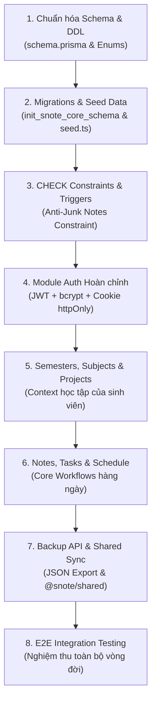

# Kế hoạch Kỹ thuật & Thực thi Bước 4 – Triển khai Backend Core & Database Migrations (SNOTE)

Tài liệu này là **bản kế hoạch kỹ thuật chính thức và chi tiết** cho **Bước 4 lớn (Triển khai Backend Core & Database Migrations)** của dự án **SNOTE**, chuyển hóa toàn bộ thiết kế dữ liệu (Bước 2) và nền tảng kiến trúc (Bước 3) thành hệ thống backend hoạt động trên dữ liệu thật.

---

## 🎯 MỤC TIÊU CỐT LÕI CỦA BƯỚC 4

1. **Database Schema & Migrations:** Áp dụng toàn bộ 10+ bảng quan hệ và 8 Enums từ `DOCS/step_2.md` vào PostgreSQL 16 qua Prisma ORM 7 + `@prisma/adapter-pg`.
2. **Ràng buộc Toàn vẹn & Chống Note Rác:** Thiết lập CHECK constraint `(subject_id IS NOT NULL OR project_id IS NOT NULL)` ngay tại tầng database.
3. **Module Auth Hoàn chỉnh:** Đăng ký, Đăng nhập, Dual-Token JWT (Access token + Refresh token cookie `httpOnly`, `Secure`), mã hóa mật khẩu bcrypt (cost factor 12).
4. **CRUD Real Data các Phân hệ Cốt lõi:**
   * `semesters` & `subjects`: Học kỳ, môn học, tín chỉ, giảng viên.
   * `projects`: Đồ án môn học, nhóm, deadline.
   * `notes`: Ghi chú bài giảng, gắn thẻ tags, soft-delete, phân loại theo môn/đồ án.
   * `tasks`: Công việc sinh viên (TODO/IN_PROGRESS/DONE), độ ưu tiên, deadline.
   * `schedule`: Lịch học, lịch thi, sự kiện nhóm theo tuần/tháng.
   * `backup`: Export toàn bộ dữ liệu tài khoản ra file JSON chuẩn.
5. **Contract Bất biến:** Đồng bộ toàn bộ interfaces và DTOs vào thư viện dùng chung `@snote/shared`.

---

## 🧭 PHÂN RÃ CÁC GIAI ĐOẠN THỰC THI

---

## 📋 THỨ TỰ THỰC THI CHI TIẾT

| Thứ tự | Hạng mục công việc | Output cụ thể |
| :---: | :--- | :--- |
| **4.1** | **Prisma Schema & Migrations** | `backend/prisma/schema.prisma` với 10+ models, 8 enums. Migration sinh ra các bảng PostgreSQL. |
| **4.2** | **Seed Data & CHECK Constraints** | `backend/prisma/seed.ts` chứa dữ liệu sinh viên mẫu; CHECK constraint trên bảng `notes` và `tasks`. |
| **4.3** | **Module Auth Hoàn chỉnh** | `backend/src/modules/auth/` (register, login, refresh, logout, me, authGuard). |
| **4.4** | **Module Semesters, Subjects & Projects** | `backend/src/modules/semesters/`, `backend/src/modules/projects/` kết nối Prisma CRUD thật. |
| **4.5** | **Module Notes & Tasks** | `backend/src/modules/notes/`, `backend/src/modules/tasks/` kết nối Prisma CRUD thật. |
| **4.6** | **Module Schedule & Backup** | `backend/src/modules/schedule/`, `backend/src/modules/backup/` kết nối Prisma CRUD thật. |
| **4.7** | **Đồng bộ Shared Contracts & API Surface** | Cập nhật `packages/shared/` và export contracts chuẩn. |
| **4.8** | **Nghiệm thu E2E Testing** | Kịch bản kiểm thử tự động toàn diện từ Auth $\rightarrow$ CRUD $\rightarrow$ Export Backup. |
