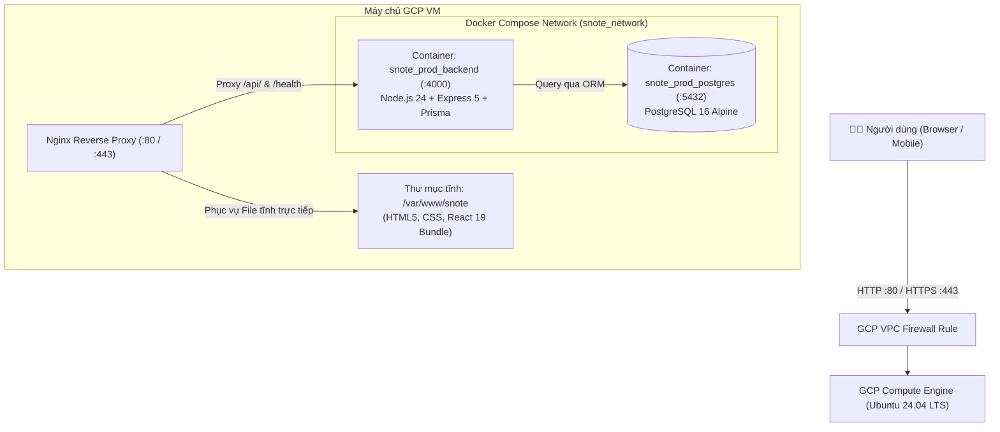

# 📘 CẨM NANG HƯỚNG DẪN TRIỂN KHAI SNOTE LÊN GOOGLE CLOUD (GCP)
### Phương án GCP Compute Engine (VM) + Docker Compose + Nginx Reverse Proxy — có thể phát sinh chi phí

Tài liệu này hướng dẫn chi tiết từng bước (từ lúc chưa có máy chủ đến khi website SNOTE chạy chính thức trên Internet) dành cho sinh viên, giảng viên và nhóm phát triển đồ án.

---

## 📑 MỤC LỤC
1. [Tổng quan Kiến trúc Hệ thống](#1-tổng-quan-kiến-trúc-hệ-thống)
2. [Chi phí & Chuẩn bị Tài nguyên GCP](#2-chi-phí--chuẩn-bị-tài-nguyên-gcp)
3. [Bước 1: Mở Firewall GCP (Cổng 80 & 443)](#bước-1-mở-firewall-gcp-cổng-80--443)
4. [Bước 2: Tạo Máy ảo Compute Engine VM](#bước-2-tạo-máy-ảo-compute-engine-vm)
5. [Bước 3: Kết nối SSH & Chạy Triển khai Tự động (1-Click)](#bước-3-kết-nối-ssh--chạy-triển-khai-tự-động-1-click)
6. [Bước 4: Cấu hình Tên miền (Domain) & SSL HTTPS Miễn phí](#bước-4-cấu-hình-tên-miền-domain--ssl-https-miễn-phí)
7. [Vận hành, Cập nhật Code & Sao lưu Dữ liệu](#7-vận-hành-cập-nhật-code--sao-lưu-dữ-liệu)
8. [Xử lý Sự cố Thường gặp (Troubleshooting)](#8-xử-lý-sự-cố-thường-gặp-troubleshooting)

---

## 1. TỔNG QUAN KIẾN TRÚC HỆ THỐNG



### Ưu điểm vượt trội của phương án này:
- **Độc lập & Tự chủ 100%**: Không phụ thuộc vào các dịch vụ PaaS bị giới hạn sleep time (như Render free tier).
- **Chi phí phụ thuộc cấu hình**: Tài khoản mới đủ điều kiện có thể dùng tín dụng Free Trial trong thời hạn của Google. Cấu hình `e2-medium` tại Singapore bên dưới không thuộc Compute Engine Free Tier.
- **Sao lưu & Di chuyển dễ dàng**: Toàn bộ database nằm trong Docker Volume, copy file backup `.sql` là chuyển server trong 3 phút.

---

## 2. CHI PHÍ & CHUẨN BỊ TÀI NGUYÊN GCP

| Hạng mục | Thông số đề xuất | Chi phí ước tính | Ghi chú |
| :--- | :--- | :--- | :--- |
| **GCP VM Machine Type** | `e2-medium` (2 vCPU, 4 GB RAM), Singapore | Tính phí theo thời gian chạy | Không thuộc Compute Engine Free Tier; xem giá hiện tại trong GCP Pricing Calculator trước khi tạo. |
| **Hệ điều hành (OS)** | Ubuntu 24.04 LTS (x86/64) | Không tính phí bản quyền Ubuntu | VM vẫn tính phí. |
| **Ổ đĩa (Boot Disk)** | 30 GB Balanced Persistent Disk | Tính phí theo dung lượng | Free Tier chỉ bao gồm tối đa 30 GB-tháng **standard** persistent disk. |
| **Băng thông mạng** | Egress Internet | Tính phí theo lưu lượng vượt hạn mức áp dụng | Compute Engine Free Tier chỉ bao gồm 1 GB/tháng từ Bắc Mỹ tới các khu vực đủ điều kiện. |

**Lưu ý:** Compute Engine Free Tier áp dụng cho một `e2-micro` tại `us-west1`, `us-central1` hoặc `us-east1`, với các giới hạn về đĩa và lưu lượng. Cấu hình `e2-medium` ở `asia-southeast1` trong hướng dẫn này **không miễn phí**. Google yêu cầu liên kết Cloud Billing ngay cả khi chỉ dùng Free Tier. Free Trial (nếu đủ điều kiện) là khoản tín dụng có thời hạn, không phải quyền sử dụng miễn phí lâu dài. Xem [điều kiện Free Tier và Free Trial](https://docs.cloud.google.com/free/docs/free-cloud-features) và [giá Compute Engine](https://cloud.google.com/products/compute/pricing).

---

## BƯỚC 1: MỞ FIREWALL GCP (CỔNG 80 & 443)

Mặc định máy ảo GCP sẽ chặn các cổng web từ ngoài Internet vào. Bạn cần mở cổng 80 (HTTP) và 443 (HTTPS).

### Cách 1: Dùng lệnh Cloud Shell (Khuyên dùng - Nhanh nhất)
Bấm vào biểu tượng **Cloud Shell** (`>_`) ở góc trên bên phải màn hình GCP Console và dán lệnh:

```bash
gcloud compute firewall-rules create allow-snote-web \
    --direction=INGRESS \
    --priority=1000 \
    --network=default \
    --action=ALLOW \
    --rules=tcp:80,tcp:443 \
    --source-ranges=0.0.0.0/0 \
    --target-tags=snote-server
```

### Cách 2: Thao tác bằng chuột trên GCP Console
1. Vào menu **VPC network** -> Chọn **Firewall**.
2. Bấm nút **+ CREATE FIREWALL RULE**.
3. Điền các trường:
   - **Name**: `allow-snote-web`
   - **Targets**: Chọn *Specified target tags*.
   - **Target tags**: Điền `snote-server`.
   - **Source IPv4 ranges**: Điền `0.0.0.0/0`.
   - **Protocols and ports**: Tích chọn *TCP*, điền `80, 443`.
4. Bấm **CREATE**.

---

## BƯỚC 2: TẠO MÁY ẢO COMPUTE ENGINE VM

### Cách 1: Dùng lệnh Cloud Shell (Chỉ mất 10 giây)
```bash
gcloud compute instances create snote-vm \
    --zone=asia-southeast1-b \
    --machine-type=e2-medium \
    --image-family=ubuntu-2404-lts-amd64 \
    --image-project=ubuntu-os-cloud \
    --boot-disk-size=30GB \
    --boot-disk-type=pd-balanced \
    --tags=snote-server,http-server,https-server
```

### Cách 2: Thao tác trên giao diện Web GCP
1. Vào menu **Compute Engine** -> Chọn **VM instances**.
2. Bấm nút **CREATE INSTANCE**.
3. Thiết lập thông số:
   - **Name**: `snote-vm`
   - **Region**: Chọn `asia-southeast1 (Singapore)` (để có độ trễ về Việt Nam thấp nhất: ~20-30ms).
   - **Machine configuration**: Chọn General-purpose -> Series `E2` -> Machine type `e2-medium` (2 vCPU, 4GB RAM).
   - **Boot disk**: Bấm *Change* -> Chọn OS: `Ubuntu`, Version: `Ubuntu 24.04 LTS`, Size: `30 GB` -> Bấm *Select*.
   - **Firewall**: Tích chọn cả 2 mục:
     - `[x] Allow HTTP traffic`
     - `[x] Allow HTTPS traffic`
   - Mở rộng mục **Advanced options** -> **Networking** -> Điền vào ô **Network tags**: `snote-server`.
4. Bấm **CREATE** và chờ khoảng 30 giây để máy ảo khởi động.

---

## BƯỚC 3: KẾT NỐI SSH & CHẠY TRIỂN KHAI TỰ ĐỘNG (1-CLICK)

Khi máy ảo đã ở trạng thái **Running** (có dấu tích xanh lá), bạn sẽ thấy cột **External IP** (ví dụ: `34.128.90.12`).

### 1. Kết nối SSH vào máy ảo
- Bấm trực tiếp vào nút **SSH** ở dòng `snote-vm` trên trình duyệt GCP Console.
- Hoặc kết nối qua Terminal máy tính:
  ```bash
  gcloud compute ssh snote-vm --zone=asia-southeast1-b
  ```

### 2. Kéo mã nguồn và chạy lệnh triển khai
Trong cửa sổ terminal màu đen của máy ảo Ubuntu, gõ 2 lệnh sau:

```bash
# 1. Kéo mã nguồn dự án từ GitHub
git clone https://github.com/naverisme/snote.git
cd snote

# 2. Chạy script tự động triển khai toàn diện
sudo bash deploy.sh
```

### 3. Script `deploy.sh` làm những gì phía sau?
1. 🔄 **Cài đặt công cụ**: Tự động cài đặt Docker, Docker Compose, Nginx, OpenSSL, UFW nếu máy ảo còn mới tinh.
2. 🔑 **Tự sinh bảo mật**: Tự động lấy External IP máy ảo, sinh mật khẩu database ngẫu nhiên và khóa bảo mật JWT 64 ký tự lưu an toàn vào `.env`.
3. ⚡ **Build Frontend tối ưu**: Dùng container Node 24 biên dịch mã nguồn React Vite thành thư mục tĩnh `/frontend/dist`.
4. 🐳 **Khởi chạy CSDL & Backend**: Chạy Docker Compose ngầm 24/7, tự động chạy `npx prisma migrate deploy` để khởi tạo bảng CSDL.
5. 🛡️ **Cấu hình Nginx & Tường lửa**: Thiết lập Nginx định tuyến `/api/` về Backend cổng 4000 và cấp quyền tường lửa cổng 80, 443.

Khi màn hình xuất hiện thông báo:
```text
==============================================================================
🎉 TRIỂN KHAI THÀNH CÔNG HỆ THỐNG SNOTE TRÊN GCP COMPUTE ENGINE!
==============================================================================
📍 Địa chỉ ứng dụng: http://<IP_MÁY_ẢO>
🔍 Kiểm tra trạng thái Backend: http://<IP_MÁY_ẢO>/health
```
👉 Bạn mở trình duyệt máy tính, gõ: `http://<IP_MÁY_ẢO>` là đã vào thẳng ứng dụng SNOTE!

---

## BƯỚC 4: CẤU HÌNH TÊN MIỀN (DOMAIN) & SSL HTTPS MIỄN PHÍ

Nếu bạn có tên miền riêng (ví dụ: `snote.sinhvienit.net` hoặc `snote.vn`):

### 1. Trỏ DNS Domain về IP máy ảo GCP
Vào trang quản lý tên miền (Cloudflare, Namecheap, v.v.):
- Thêm Record:
  - **Type**: `A`
  - **Host/Name**: `snote` (hoặc `@` nếu dùng domain chính)
  - **Points to (Value)**: `Địa chỉ External IP của máy ảo GCP`
  - **TTL**: `Auto` hoặc `300s`

### 2. Cài chứng chỉ SSL HTTPS miễn phí (Certbot Let's Encrypt)
Trên terminal SSH của máy ảo GCP, chạy lệnh:

```bash
# Cài công cụ Certbot Nginx
sudo apt install -y certbot python3-certbot-nginx

# Lấy chứng chỉ SSL tự động (thay tên miền của bạn vào)
sudo certbot --nginx -d snote.yourdomain.com
```

*Nhập email của bạn và chọn `Agree (Y)`.*
Certbot sẽ tự động cấu hình HTTPS và tự động gia hạn 3 tháng/lần vĩnh viễn miễn phí!

Website của bạn lúc này đã đạt chuẩn bảo mật xanh lá: `https://snote.yourdomain.com`.

---

## 7. VẬN HÀNH, CẬP NHẬT CODE & SAO LƯU DỮ LIỆU

### A. Cách cập nhật Code mới khi có bản Update (Update Deployment)
Mỗi khi bạn commit code mới lên GitHub, trên máy ảo GCP bạn chỉ cần vào thư mục dự án và gõ:

```bash
cd ~/snote
git pull origin main
sudo bash deploy.sh
```
*Script sẽ tự động re-build frontend và restart backend mà không làm mất dữ liệu database!*

### B. Kiểm tra Log hệ thống thời gian thực
```bash
# Xem log Backend API
docker compose -f docker-compose.prod.yml logs -f --tail=50 backend

# Xem log Database PostgreSQL
docker compose -f docker-compose.prod.yml logs -f --tail=50 postgres_db

# Xem log Nginx truy cập web
sudo tail -f /var/log/nginx/access.log
```

### C. Sao lưu Cơ sở dữ liệu ra 1 tệp duy nhất (Backup Database)
```bash
# Tạo file backup có đính kèm ngày giờ
docker exec -t snote_prod_postgres pg_dump -U snote_prod_user snote_prod_db > snote_backup_$(date +%Y%m%d).sql

echo "File backup đã được lưu tại: $(pwd)/snote_backup_$(date +%Y%m%d).sql"
```

### D. Khôi phục Dữ liệu từ file Backup (Restore Database)
```bash
cat snote_backup_20261029.sql | docker exec -i snote_prod_postgres psql -U snote_prod_user -d snote_prod_db
```

---

## 8. XỬ LÝ SỰ CỐ THƯỜNG GẶP (TROUBLESHOOTING)

### 1. Không truy cập được vào IP máy ảo từ trình duyệt (ERR_CONNECTION_TIMED_OUT)
- **Nguyên nhân**: Bạn chưa tạo Firewall Rule mở cổng 80 trên GCP.
- **Cách sửa**: Chạy lại lệnh mở firewall ở **Bước 1** hoặc kiểm tra xem máy ảo đã được gán thẻ tag `snote-server` chưa:
  ```bash
  gcloud compute instances add-tags snote-vm --zone=asia-southeast1-b --tags=snote-server
  ```

### 2. Frontend báo lỗi "Lỗi kết nối máy chủ" hoặc không đăng nhập được
- **Nguyên nhân**: Backend container chưa khởi động xong hoặc bị lỗi kết nối DB.
- **Cách kiểm tra**:
  ```bash
  curl http://127.0.0.1:4000/health
  ```
  Nếu không ra `{"status":"ok"}`, hãy kiểm tra log:
  ```bash
  docker compose -f docker-compose.prod.yml logs backend
  ```

### 3. Khởi động lại toàn bộ cụm container
```bash
cd ~/snote
docker compose -f docker-compose.prod.yml restart
```

---

> [!TIP]
> Toàn bộ quy trình trên đã được kiểm chứng chuẩn xác với kiến trúc Monorepo của SNOTE. Kịch bản `deploy.sh` bảo vệ tối đa tính toàn vẹn của dữ liệu và tự động hóa 100% các công đoạn phức tạp.
