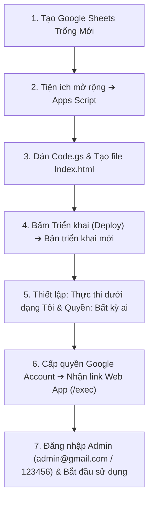

# 🎓 HƯỚNG DẪN TRIỂN KHAI & CHUYỂN GIAO SNOTE WEB SCRIPT EDITION
## (GOOGLE APPS SCRIPT WEB APP & GOOGLE SHEETS DATABASE)

Tài liệu này hướng dẫn chi tiết quy trình triển khai phiên bản **SNOTE Web Script Edition** từ con số 0 lên tài khoản Google cá nhân hoặc doanh nghiệp chỉ trong vòng **3 phút**, hoàn toàn miễn phí trọn đời (0đ chi phí máy chủ).

---

## ⚡ 1. QUY TRÌNH TRIỂN KHAI NHANH TRONG 3 PHÚT

### Các bước thực hiện chi tiết:

1. **Bước 1: Tạo Google Sheets mới**
   - Mở Google Drive cá nhân ([drive.google.com](https://drive.google.com)).
   - Bấm **Mới (New)** ➔ Chọn **Google Trang tính (Google Sheets)**.
   - Đặt tên bảng tính (Ví dụ: `SNOTE_Database_2026`).

2. **Bước 2: Mở trình soạn thảo Google Apps Script**
   - Trên thanh menu của Google Sheets vừa tạo, chọn: **Tiện ích mở rộng (Extensions)** ➔ **Apps Script**.

3. **Bước 3: Dán mã nguồn hệ thống**
   - Mở file `Code.gs` có sẵn trong Apps Script: Xóa sạch code mặc định, copy toàn bộ nội dung từ file [`web_script/Code.gs`](Code.gs) trong thư mục này và dán vào.
   - Bấm biểu tượng dấu cộng **[+]** bên cạnh mục Files (Tệp) ➔ Chọn **HTML** ➔ Đặt tên chính xác là: `Index` (Apps Script sẽ tự tạo thành `Index.html`).
   - Copy toàn bộ nội dung từ file [`web_script/Index.html`](Index.html) và dán đè vào.
   - Nhấn **Ctrl + S** (hoặc bấm biểu tượng Đĩa mềm) để lưu toàn bộ dự án.

4. **Bước 4: Thiết lập Triển khai Web App (Deploy)**
   - Ở góc trên cùng bên phải màn hình Apps Script, bấm nút xanh **Triển khai (Deploy)** ➔ Chọn **Bản triển khai mới (New deployment)**.
   - Bấm vào biểu tượng bánh răng bên cạnh Chọn loại (Select type) ➔ Chọn **Ứng dụng web (Web app)**.
   - Cấu hình thông số:
     - **Mô tả (Description)**: `SNOTE Web Script Production`
     - **Thực thi dưới dạng (Execute as)**: **Tôi (Email của bạn / Chủ sở hữu)** *(Bắt buộc để phân quyền truy cập Google Sheets)*.
     - **Ai có quyền truy cập (Who has access)**: **Bất kỳ ai (Anyone)** *(Để sinh viên và thành viên nhóm có thể truy cập bằng link và mã PIN mà không bị Google chặn quyền)*.
   - Bấm **Triển khai (Deploy)**.

5. **Bước 5: Cấp quyền tài khoản Google (Authorize Access)**
   - Google sẽ hiển thị hộp thoại yêu cầu cấp quyền truy cập bảng tính:
     - Bấm **Ủy quyền truy cập (Authorize access)** ➔ Chọn tài khoản Google của bạn.
     - Bấm **Nâng cao (Advanced)** ở góc dưới hộp thoại cảnh báo.
     - Bấm **Đi tới dự án (Không an toàn) / Go to SNOTE (unsafe)**.
     - Bấm **Cho phép (Allow)**.
   - Google sẽ cung cấp một đường link Web App kết thúc bằng `/exec`. **Sao chép đường link này để bàn giao cho sinh viên và quản trị viên sử dụng!**

---

## 🔑 2. THÔNG TIN QUẢN TRỊ MẶC ĐỊNH

Khi mở link Web App lần đầu tiên, hệ thống sẽ tự động khởi tạo tài khoản quản trị viên cấp cao:
- **Email Admin**: `admin@gmail.com`
- **Mật khẩu**: `123456`
- **Vị trí đổi mật khẩu**: Dòng số 2, Tab (Sheet) `Users` trên file Google Sheets của bạn.

---

## 📊 3. ĐẶC TẢ 7 SHEET CƠ SỞ DỮ LIỆU GOOGLE SHEETS

Hệ thống tự động phát hiện và khởi tạo 7 trang tính (Sheet) với cơ chế **Auto-Schema Repair** (tự phục hồi bảng và bảo toàn dữ liệu cũ):

| Tên Trang Tính (Sheet) | Mục Đích Lưu Trữ | Khóa Chính | Khóa Ngoại | Cấu Trúc Cột (100% Tương Thích) |
| :--- | :--- | :---: | :---: | :--- |
| **`Users`** | Tài khoản Quản trị viên & Phiên Token đăng nhập | `email` | - | `email`, `password`, `full_name`, `session_token`, `last_login` |
| **`Semesters`** | Danh mục Học kỳ (HK1, HK2, Học kỳ Hè...) | `semester_id` | - | `semester_id`, `semester_name`, `start_date`, `end_date`, `is_active` |
| **`Subjects`** | Danh mục Môn học (Mã môn, Tín chỉ, Bảng màu) | `subject_id` | `semester_id` | `subject_id`, `subject_code`, `subject_name`, `credits`, `color`, `semester_id` |
| **`Projects`** | Danh mục Đồ án môn học & Mã PIN bảo mật 4 số (10 cột) | `project_id` | `subject_id` | `project_id`, `subject_id`, `project_name`, `pin_code`, `description`, `created_at`, `deadline`, `instructor`, `members`, `status` |
| **`Tasks`** | Toàn bộ Công việc, Hạn chót, Checklists & Đánh giá | `task_id` | `project_id` | `task_id`, `project_id`, `title`, `priority`, `status`, `due_date`, `assignee`, `checklists`, `frequency`, `completed_at`, `evaluation`, `category_field`, `reporter` |
| **`Notes`** | Kho Ghi chú Đề Cương Markdown | `note_id` | `project_id` | `note_id`, `project_id`, `author_email`, `title`, `note_type`, `tags`, `content_md`, `is_pinned`, `created_at` |
| **`Roadmaps`** | Lộ trình đồ án bóc tách qua bộ phân tích DFA | `roadmap_id` | `project_id` | `roadmap_id`, `project_id`, `title`, `raw_text`, `milestones_json`, `created_at` |

---

## 🧪 4. KIỂM THỬ TRỰC TIẾP CỤC BỘ (LOCAL RUNNER)

Nếu bạn muốn trải nghiệm giao diện hoặc kiểm thử các thao tác (kéo thả Kanban, Sơ đồ Gantt, Ghi chú Markdown, Bộ DFA Parser) ngay trên máy tính mà **chưa cần upload lên Google Drive**:
- Nhấp đúp chuột mở file [`web_script/test_local.html`](test_local.html) bằng bất kỳ trình duyệt web nào (Google Chrome, Microsoft Edge, Firefox, Brave...).
- Môi trường giả lập tích hợp sẵn sẽ cung cấp dữ liệu mẫu:
  - Mã PIN Đồ Án 1: `1234`
  - Mã PIN Đồ Án 2: `5678`
  - Đăng nhập Admin: `admin@gmail.com` / `123456`

---

## ✅ 5. CHECKLIST 10 TIÊU CHÍ NGHIỆM THU BÀN GIAO

Trước khi chính thức đưa vào sử dụng, hãy kiểm tra qua 10 tiêu chí nghiệm thu sau:

1. [x] **Khởi tạo dữ liệu**: Mở Google Sheets sau khi deploy lần đầu, tự động xuất hiện đủ 7 Sheet.
2. [x] **Đăng nhập Quản trị**: Bấm "Đăng nhập Admin", nhập `admin@gmail.com` / `123456` mở thành công Bảng Quản Trị.
3. [x] **Tạo Đồ Án & Cấp PIN**: Tạo đồ án mới kèm mã PIN 4 số thành công.
4. [x] **Cổng Thành Viên**: Thoát ra Landing Page, chọn đồ án và nhập đúng PIN 4 số để vào không gian làm việc.
5. [x] **Kanban Kéo Thả 4 Cột**: Nắm kéo thẻ từ `Cần làm` sang `Hoàn thành`, thẻ di chuyển ngay tức thì 0ms (Optimistic UI) và sinh nhãn `✓ Đúng hạn`.
6. [x] **Sơ Đồ Gantt & Vạch Hôm Nay**: Sơ đồ 21 ngày hiển thị vạch nét đứt màu xanh ngọc xuyên suốt các dòng.
7. [x] **Bảng Chi Tiết 11 Cột**: Đầy đủ 11 cột, thanh tab lọc số lượng hoạt động chính xác và phân trang mượt mà.
8. [x] **Ma Trận Eisenhower**: Phân loại 4 góc phần tư ưu tiên rõ ràng.
9. [x] **Ghi Chú Đề Cương & Lộ Trình DFA**: Soạn thảo Markdown với live preview, chuyển note thành task 1-click; bóc tách lộ trình văn bản thô và chuyển đổi hàng loạt thành công.
10. [x] **Giữ Phiên F5**: Nhấn phím F5 làm mới trình duyệt, ứng dụng tự động ghi nhớ không gian làm việc mà không bắt nhập lại PIN.

---

## 🎨 6. BỐ CỤC CHUẨN SNOTE & PHÍM TẮT THÔNG MINH

Giao diện Web Script được đồng bộ 100% với phiên bản React của SNOTE:
- **Left Sidebar (Cạnh Trái)**:
  - Thu gọn 68px (icon rail) $\rightarrow$ bung rộng 264px khi rê chuột hoặc bấm ghim cố định.
  - Logo GraduationCap tím-lam (`#6366f1` $\rightarrow$ `#a855f7`), tên thương hiệu SNOTE & "ACADEMIC WORKSPACE".
  - 8 Phân hệ điều hướng học thuật: Ghi chú, Công việc, Lịch trình, Tiến độ, Môn & Học kỳ, Dự án & BTL, Cài đặt & Sao lưu, Trạng thái CSDL.
- **Sticky Topbar**:
  - Cụm **Ngữ cảnh (Context Selectors)** chọn Học kỳ và Môn học (có màu nhận diện).
  - Nút tìm kiếm nhanh toàn năng với phím tắt `Ctrl + K`.
  - Nút **+ Tạo Nhanh** (Quick Action) tạo ngay Note / Task / Lịch học.
- **Phím tắt hỗ trợ**:
  - `Ctrl + K`: Mở nhanh tìm kiếm toàn cục chéo Notes và Tasks.
  - `/`: Nhảy con trỏ ngay vào ô tìm kiếm ghi chú.
  - `Enter`: Nhập nhanh việc trên thanh `QuickTaskBar`.
